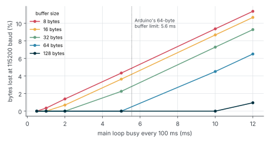

# UART Ring Buffer

[](https://github.com/HannaBeshoy/uart-ring-buffer/actions/workflows/ci.yml)

**Data Structures and Algorithms course project** · University of Debrecen, Faculty of Informatics · C, Arduino (ATmega328P) · **verified on a simulated ATmega328P; board test planned for the December lab day**

A serial port delivers a byte every 87 µs at 115200 baud, whether or not the program is ready. The receive interrupt has to store each byte in a few microseconds and the main loop has to read them later, in order. This project builds that buffer, a circular FIFO queue, in C, tests it, measures how big it must be, and runs it on a real ATmega328P core. It also contains a small tested C version of every data structure and algorithm in the course.

- [x] Ring buffer: one writer (interrupt) and one reader (main loop) without disabling interrupts; every slot usable; O(1) put and get
- [x] Compared with a linked-list queue: 4.5 times slower on a PC and 5 bytes of RAM per stored byte on the ATmega328P
- [x] 10 unit tests (2,323 checks), including 200,000 random operations against a reference model and 2 million bytes between two threads
- [x] Self-test on a simulated ATmega328P (simavr): 31,602 bytes from a timer interrupt, none reordered, drops exactly as predicted
- [x] Arduino sketch that uses the buffer as the real UART receive buffer
- [x] 15 lecture demos (163 checks): lists, stacks, queues, sparse matrices, seven sorting algorithms, heaps, hash tables, binary search trees, AVL trees, graphs
- [ ] Lab day: the sketch on a real Arduino ([test sheet](docs/LAB_DAY.md))

## How big must the buffer be?



`bench/uart_burst.c` runs the real `ring_buffer.c` in 1 µs steps for 10 simulated seconds: bytes arrive every 86.8 µs, and every 100 ms the main loop is busy for a while (an SD-card write, a display update). A buffer survives a stall when it holds every byte that arrives during it:

    capacity ≥ stall time × 11.52 bytes per ms   (115200 baud, 10 bits per byte)

So Arduino's built-in 64-byte receive buffer survives a 5 ms stall but loses 4.5 % of the data with a 10 ms stall; a 128-byte buffer survives 10 ms. The fix for a longer stall is not a bigger buffer but a main loop that never blocks that long.

## Design

```c
typedef struct {
    volatile uint8_t *data;    // capacity bytes, capacity a power of two (2..128)
    uint8_t mask;              // capacity - 1, so the slot is index & mask
    volatile uint8_t head;     // written only by the interrupt
    volatile uint8_t tail;     // written only by the main loop
    volatile uint16_t dropped; // bytes refused because the buffer was full
} ring_buffer_t;
```

- **Free-running 8-bit indices.** head and tail just count up and wrap at 256. The number of stored bytes is always `(uint8_t)(head - tail)`, even across the wrap, so all slots can be used (the textbook array queue keeps one slot empty or a separate counter).
- **No locks.** Only the interrupt writes head and only the main loop writes tail, and on an 8-bit AVR an 8-bit read or write is one instruction, so neither side can see half an update. The 16-bit counters (`dropped`, and the sketch's byte total) are read with interrupts off.
- **Order of writes.** The interrupt stores the byte before it moves head; the main loop takes the byte before it moves tail. The storage is `volatile`, so the compiler keeps that order. On a multi-core ARM this would need C11 release/acquire atomics, which the comments point out.
- **When full, the newest byte is dropped** and counted; old data is never overwritten, so a line that is already in the buffer stays intact.

| | Ring buffer | Linked-list queue |
| --- | ---: | ---: |
| time per operation (this PC) | 2.8 ns | 12.6 ns |
| RAM per stored byte (ATmega328P) | 1 byte | 5 bytes (data, next pointer, malloc header) |
| maximum size | fixed | until the heap runs out |
| safe in an interrupt | yes | no (`malloc` is not re-entrant) |

## Lecture demos

`demos/` has one tested file per topic of the course slides (page numbers of *DataStructures-2026.pdf*):

| File | Topics |
| --- | --- |
| `algorithms.c` | min and max with 3n/2 comparisons, Horner's method, fast exponentiation (pp. 18–41) |
| `linked_list.c`, `self_organising.c` | singly linked list; move-to-front, transpose and counter heuristics (pp. 55–62, 87) |
| `stack.c`, `array_queue.c`, `sparse.c` | stack with bracket matching and RPN; cyclic array queue; triplet sparse matrix (pp. 63–84) |
| `sort.c` | bubble (tuned), insertion, ranking, merge (recursive and iterative), quick, heap, bin sort; parallel odd-even sort; binary search (pp. 89–100, 214) |
| `heap.c`, `hash.c` | minimum heap and priority queue; open addressing with linear probing and "deleted" marks, chaining (pp. 101–137) |
| `bst.c`, `avl.c` | binary search tree with successor and deletion, three traversals and breadth-first; AVL insertion with single and double rotations (pp. 138–178) |
| `graph.c` | BFS, DFS, Euler circuit test, 2-colouring, Dijkstra (pp. 193–208) |

The hash-table test reproduces the worked example on p. 107 and found a slip in it: the slide gives ĥ(13) = 3, but 13 · 1.618 = 21.034, so ĥ(13) = 0. With the slide's value the test gets the slide's table; with the correct value, 13 lands in slot 2 and 8 in slot 4.

## Running it

```bash
make test     # ring buffer and demo tests (demos with address and undefined-behaviour sanitizers)
make bench    # timing comparison and the UART burst simulation -> results/
make sketch   # compile the Arduino sketch for the ATmega328P (gcc-avr)
make avr      # run the self-test on a simulated ATmega328P (simavr)
python3 docs/figures.py
```

On Ubuntu: `sudo apt install gcc make gcc-avr avr-libc simavr`. The same steps run on every push in GitHub Actions.

**On an Arduino:** open `arduino/uart_ring_buffer/uart_ring_buffer.ino` in the Arduino IDE, upload, and open the Serial Monitor at 115200 baud with "Newline". Type a line; `stats`, `slow <ms>` and `reset` show the buffer at work. The sketch keeps its own copy of the ring buffer (the IDE only compiles the sketch folder); `make test` checks the copy is identical.

## Repository layout

```text
src/        ring_buffer.c (the project) and list_queue.c (the comparison)
tests/      unit tests and a tiny test framework (check.h)
demos/      one tested file per lecture topic
bench/      timing comparison and the UART burst simulation
avr/        self-test for the ATmega328P, run in simavr
arduino/    the sketch for the lab day
results/    output of the last runs
docs/       project guide, lab-day test sheet, figure script
```

See the [project guide](docs/PROJECT_GUIDE.md) for how each part maps to the course.

## Author

Beshoy Hanna · Computer Science Engineering BSc, University of Debrecen · [LinkedIn](https://www.linkedin.com/in/beshoy-hanna-8b52213a0)
